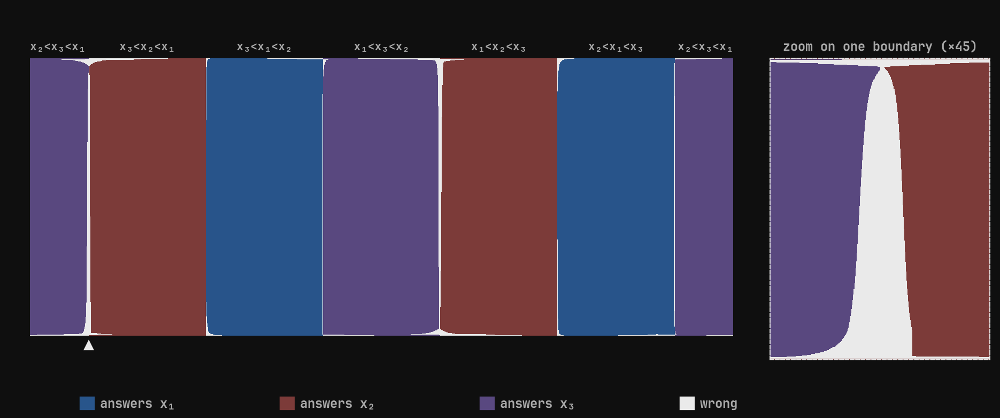
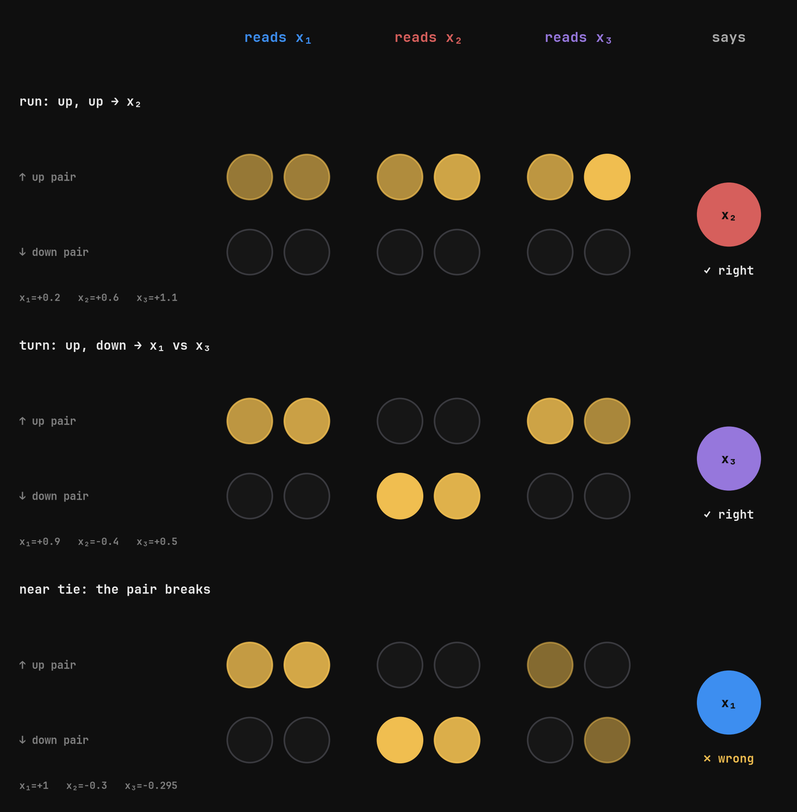
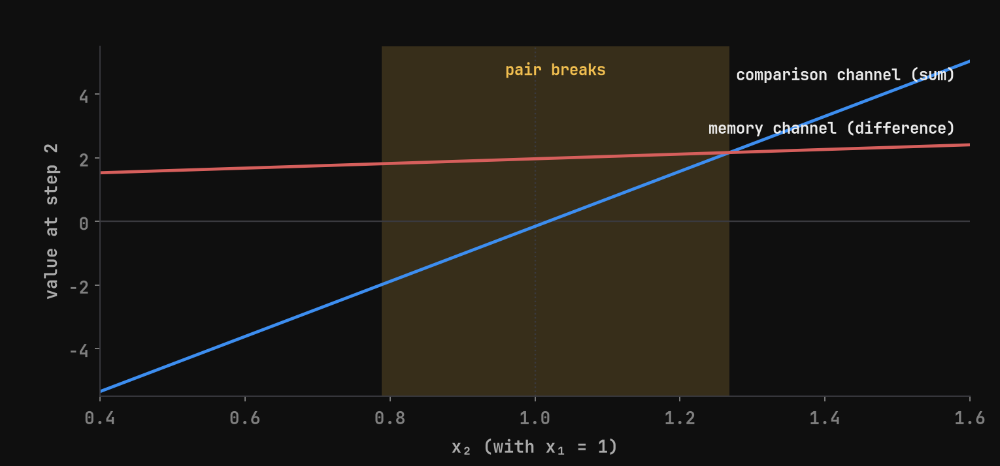
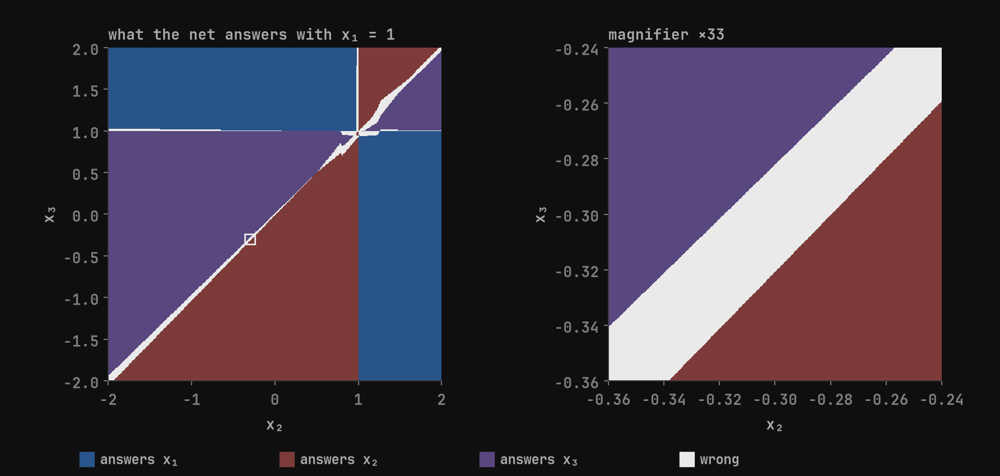
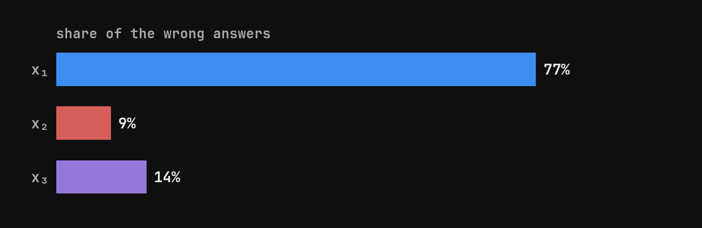
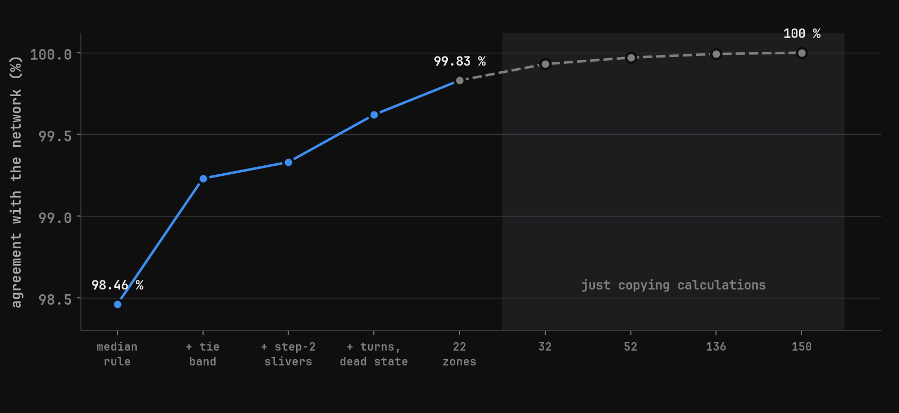
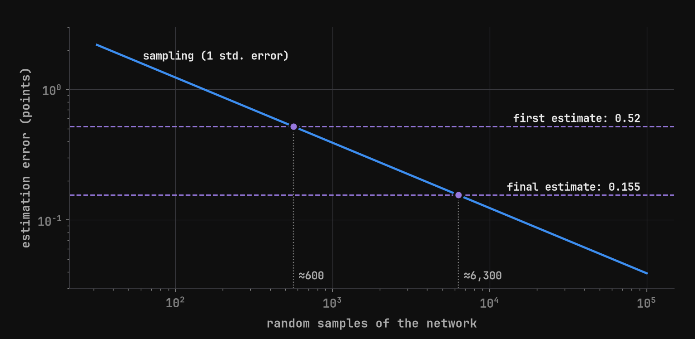
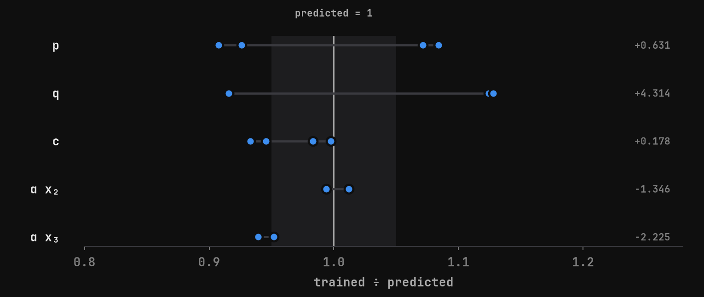

# Leeuwenhoek

Taking apart the tiny networks of ARC's [AlgZoo](https://github.com/alignment-research-center/alg-zoo), one specimen at a time.

ARC published AlgZoo in January 2026: RNNs and transformers with 8 to 1,408 parameters, trained on
algorithmic tasks, and the challenge of understanding them completely. Published work so far covers
the *2nd argmax* family. This project starts with **argmedian**, which no one had explained in public
as far as we could find (November 2026): its 32-parameter RNN reads three numbers and says which one
is the median, and gets it right 98.46% of the time.



Written up in [Taking apart a 32-number network](https://xabier.me/posts/2026-11-08-taking-apart-a-32-number-network).

## What the network does

The network has no biases, so its answer depends only on the direction of the input. With Gaussian
inputs every direction is equally likely, which turns accuracy into an area on a sphere (above):
the errors are thin lines on the boundaries where two numbers tie.



The four neurons are two mirror pairs: one pair fires when the new number is higher than the last,
the other when it is lower. Up then up (or down then down) means the median is x₂; a turn means x₂ is
an extreme and the answer is x₁ against x₃.



Read as sum and difference, each pair carries two channels: a large **comparison** channel whose
sign says up or down, and a small **memory** channel that rebuilds the previous number for the next
comparison.

## Where it fails



Near a tie the comparison falls below the memory and the pair breaks: one neuron of each pair stays
on, or all of them go off. The readout then loses the comparison and the first position wins by
default.



## How results are verified

An explanation only counts when it survives the round trip: a twin built from it must give the same
answer as the network, input by input.



Mechanisms derived from the weights reach 99.83% agreement with 22 zones. Closing the last 0.17%
takes 150 zones and adds no understanding, but it does close the loop: 0 differences against the
network in float64 over 4 million inputs.



The exact accuracy comes from the weights alone, by enumerating the 70 activation paths and summing
the exact Gaussian area of each piece. ARC's metric then asks how well an explanation estimates it
without running the network: ours lands 0.155 points away, what random sampling reaches with about
6,300 runs.



Finally, a network built from the explanation alone: requiring an exact comparison, a memory that
keeps just enough to rebuild the previous number, and a median readout fixes every weight except the
memory size and how much it forgets. Reading those two from the trained network predicts the rest of
its weights, and the built network scores 98.52% (the trained one, 98.455%).

| | |
|---|---|
| Exact accuracy from the weights | h=2: 41.017126%, h=4: 98.455038%, h=8: 99.945490% |
| argmedian h=4: mechanisms | 22 zones, 99.83% agreement with the network |
| argmedian h=4: round trip | 150 zones, 0 differences in float64 over 4 million inputs |
| argmedian h=4: estimate | 0.149 points from the exact accuracy, without running the network |
| Built from the explanation | 2 free numbers, 98.52% accuracy |
| Tests | 25 |

## Usage

Requires Python 3.11 or later and [uv](https://docs.astral.sh/uv/). The weights are downloaded from AlgZoo on
first use and cached in `data/weights/`.

```sh
uv sync
uv run pytest
uv run python scripts/exact_accuracy_table.py      # exact accuracy of argmedian h=2, 4, 8
uv run python scripts/mechanisms_h4.py             # the 22 mechanism zones and the round trip
uv run python scripts/design_twin_h4.py            # the network built from the explanation
uv run python scripts/blog_figures.py --lang en    # the figures in this README
```

To look at the network interactively, open [`notebooks/h4.ipynb` in Google Colab](https://colab.research.google.com/github/Xabilimon1/leeuwenhoek/blob/main/notebooks/h4.ipynb).

## Repository

| | |
|---|---|
| `src/leeuwenhoek/` | forward pass, exact path enumeration, Gaussian cone areas, twins, mechanisms, the designed network |
| `scripts/` | one script per result; every number in the notes and the post comes from one of them |
| `tests/` | unit tests, each checked by mutation |
| `notes/` | lab notes per specimen (in Spanish) |
| `docs/` | plan and summaries (in Spanish) |
| `figures/` | rendered figures |
| `agents/` | protocol of the study on AI coding agents (in preparation) |

## Next

- The error law: why the error is proportional to (b / (e × a))², and why training kept a memory ten
  times larger than needed.
- Climbing argmedian to larger models, then *median* and *longest cycle*.
- How AI coding agents do on the same task, in a clean directory without these notes.

## Notes

Not affiliated with ARC. The code was written with Claude Code; the analysis, decisions and posts are
Xabier Ariznabarreta's.

## License

[MIT](LICENSE).
